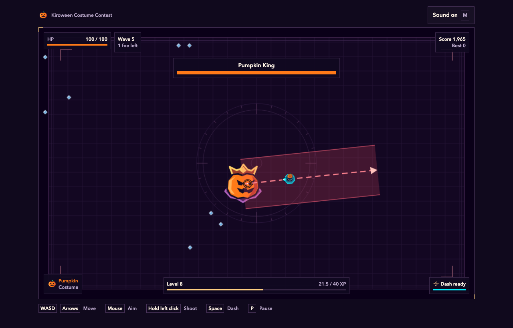

# Neon Hallows Arena

Survive a Halloween horde in a neon arena. Walk over a costume to swap powers mid-fight, collect XP for lasting upgrades, and take on a boss every five waves.



## Play locally

Clone the repository or download it from GitHub. Double-click the local copy of [index.html](index.html) and select **Enter the arena**. Use a desktop browser with a keyboard and mouse. All artwork, sound, and game code are inside the HTML file, so it opens offline with no build step.

You can also run a static server from the project directory.

```sh
python3 -m http.server 8000 --bind 127.0.0.1
```

Open [localhost:8000](http://127.0.0.1:8000/index.html) while the server is running.

## Controls

| Input | Action |
| --- | --- |
| `Enter` | Start a run from the title screen. |
| `WASD` or arrow keys | Move. |
| Mouse | Aim. |
| Hold left click | Fire continuously. |
| `Space` | Dash. |
| `P` | Pause or resume. |
| `M` | Toggle sound. |
| `1`, `2`, or `3` | Select an upgrade card. You can also click it. |
| `R` | Restart from the results screen. |

## Choose what you wear

You wear one costume at a time. A pickup replaces your current outfit immediately, and unclaimed costumes disappear after 12 seconds. Upgrade cards stay with you for the rest of the run.

| Costume | Power |
| --- | --- |
| Pumpkin | Shots deal splash damage around the point of impact. |
| Ghost | Dash through enemies with longer protection and a shorter cooldown. |
| Vampire | Heal on kills, with a larger heal for elites and bosses. |
| Witch | Fire one extra projectile per shot. |
| Skeleton | Land more frequent and more damaging critical hits. |
| Zombie | Increase maximum HP and regenerate health over time. |

Collect XP gems and choose one of three cards when you level up. Each wave clear awards points, restores up to 8 HP, and gives you three seconds to collect drops. The Pumpkin King, Ghost Lord, and Skeleton Monarch lead waves 5, 10, and 15. From wave 20 onward, stronger versions rotate back in. Every boss drops a costume.

The results screen shows your score, wave, kills, and survival time. The best score is saved in the browser for the address you used to play.

## Watch a run

The 72-second silent demo shows a costume swap, an upgrade choice, and the Pumpkin King and Ghost Lord fights. [Gameplay demo](demo/neon-hallows-arena-demo.mp4)

[Costume decision](screenshots/01-costume-choice.png) · [Boss charge warning](screenshots/02-pumpkin-king.png) · [Upgrade cards](screenshots/03-upgrade-cards.png)

## Project documents

The game uses Canvas 2D for artwork, Web Audio for sound effects, and a fixed-step simulation for combat. The verification log covers desktop controls, offline and HTTP launches, the costume and boss rules, and the 100-enemy performance test.

- [Gameplay requirements](.kiro/specs/halloween-neon-arena/requirements.md)
- [Game architecture](.kiro/specs/halloween-neon-arena/design.md)
- [Tasks and verification results](.kiro/specs/halloween-neon-arena/tasks.md)
- [Visual design](DESIGN.md)
- [Kiroween submission notes](DEVPOST.md)
